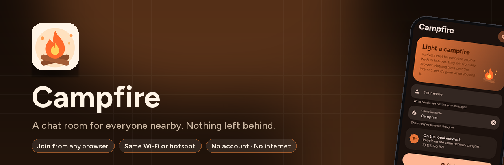
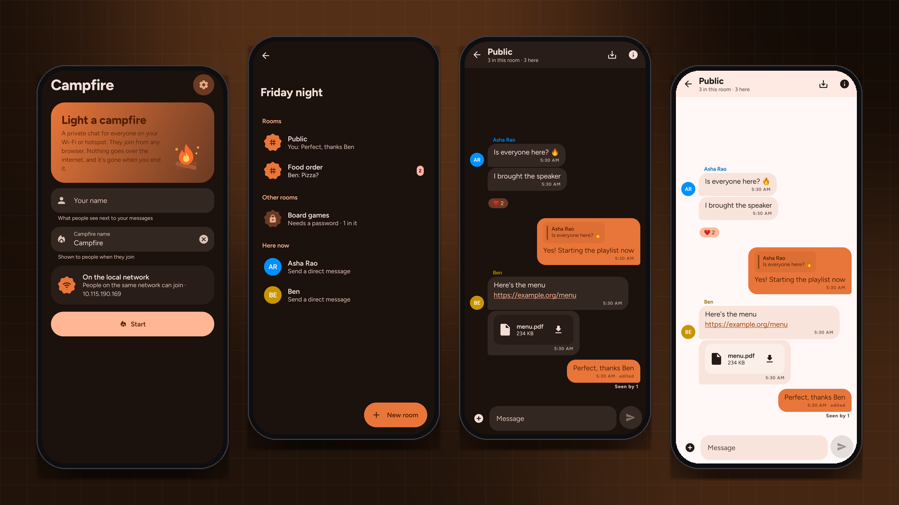
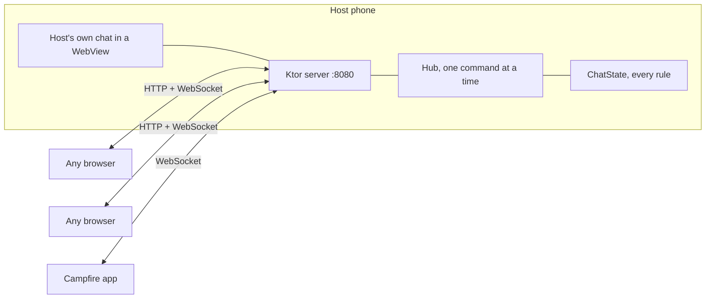

<div align="center">



<br><br>

[](https://developer.android.com)
[](https://kotlinlang.org)
[](https://ktor.io)
[](LICENSE)
[](https://prempoddar.github.io/Campfire/)

**[Website](https://prempoddar.github.io/Campfire/)** · **[Download](https://github.com/PremPoddar/Campfire/releases)** · **[Privacy](https://prempoddar.github.io/Campfire/privacy/)** · **[Report a problem](https://github.com/PremPoddar/Campfire/issues)**

</div>

---

**One phone hosts. Everyone else opens a link. No accounts, no internet, nothing left behind.** Start
a Campfire on your phone and it shows a link and a QR code. Anyone on the same Wi-Fi, or connected to
your hotspot, opens it in any browser, picks a name and is chatting. When you end it, every message,
room and file is gone.

<p align="center"></p>
<p align="center"><sub>Real screens, drawn by the app's own code.</sub></p>

## ✨ Highlights

| | |
|---|---|
| 🔥 **Public room** | Everyone lands in Public. It's always there. |
| 🔒 **Rooms** | Anyone can start a room, optionally with a password. |
| 💬 **Direct messages** | Private one-to-one chats with anyone here. |
| ↩️ **Replies &amp; reactions** | Quote a message, react with emoji, edit or delete your own. |
| 📊 **Polls &amp; pins** | Ask the room something, pin what matters, mute what doesn't. |
| 🎙️ **Voice notes** | Record and send from the app or the browser. |
| 👀 **Read receipts** | "Seen by 3" in rooms, Sent and Seen in direct messages. |
| ✍️ **Typing &amp; presence** | Who's typing, who's online, and glowing dots showing who is in each room. |
| 📎 **Files** | Any file, any size. Photos and videos play inline. |
| 🔗 **Link previews** | The host phone fetches titles and pictures so everyone sees them, even offline. |
| 🛡️ **Moderation** | Room creators remove people from their rooms; the host can remove anyone. |
| 💾 **Save the chat** | Keep a copy of a conversation before the fire goes out. |

## 🧭 How it works



```
 host phone                                       anyone on the network
┌──────────────────────────────────────┐         ┌───────────────────────┐
│ Campfire app                          │  http   │ any browser           │
│  ├─ foreground service                │◀───────▶│  index.html + ES      │
│  │   └─ Ktor CIO server :8080         │   ws    │  modules (Preact+htm) │
│  │        ├─ /       web client       │         └───────────────────────┘
│  │        ├─ /ws     chat (JSON)      │
│  │        ├─ /api/upload, /files/…    │
│  │        └─ Hub ─▶ ChatState (rules) │
│  └─ host's own chat in a WebView      │
└──────────────────────────────────────┘
```

- `core/ChatState` holds every rule (rooms, passwords, admins, direct messages, edits, reactions,
  receipts, typing, polls, pins) as plain Kotlin. Each command returns the events to send and who gets
  them, so the rules are unit tested without sockets.
- `server/Hub` runs commands one at a time under a lock and queues events per socket.
- Uploads stream straight to disk over HTTP, so a big file never blocks the chat. Videos are served
  with byte ranges so they seek.
- The browser client has no build step: Preact and htm are vendored, the font is bundled, and nothing
  is loaded from the internet.

## 🔐 Privacy, honestly

- Nothing is stored after a Campfire ends. Files live in the app's cache and are wiped on start and stop.
- It is **not encrypted**. Browsers only allow encryption and HTTPS-only features on secure pages, and a
  local network can't have a trusted certificate without warnings. Someone watching the same Wi-Fi
  could read messages and room passwords, and direct messages pass through the host phone. The app and
  the web chat both say this plainly.
- Link previews are fetched by the host phone. It refuses any address on the local network, so a link
  can't be used to probe the router or other devices.
- Uploaded files are never served as web pages or scripts.

Full policy: **[prempoddar.github.io/Campfire/privacy](https://prempoddar.github.io/Campfire/privacy/)**.

## 🛠️ Building and testing

Requires JDK 17 or 21 for Gradle.

```bash
./gradlew assembleDebug
./gradlew testDebugUnitTest
```

<details>
<summary><strong>Working on the web client</strong></summary>

<br>

```bash
CAMPFIRE_DEV=1 ./gradlew testDebugUnitTest --tests '*DevServer*'
```

starts a real Campfire on http://localhost:8080 that serves `app/src/main/resources/web` straight from
disk; reload the page to see changes. Open a second browser profile (or http://127.0.0.1:8080) to chat
with yourself.

</details>

## 📄 License

[Apache 2.0](LICENSE). Figtree is used under the SIL Open Font License. Preact and htm are MIT licensed.
